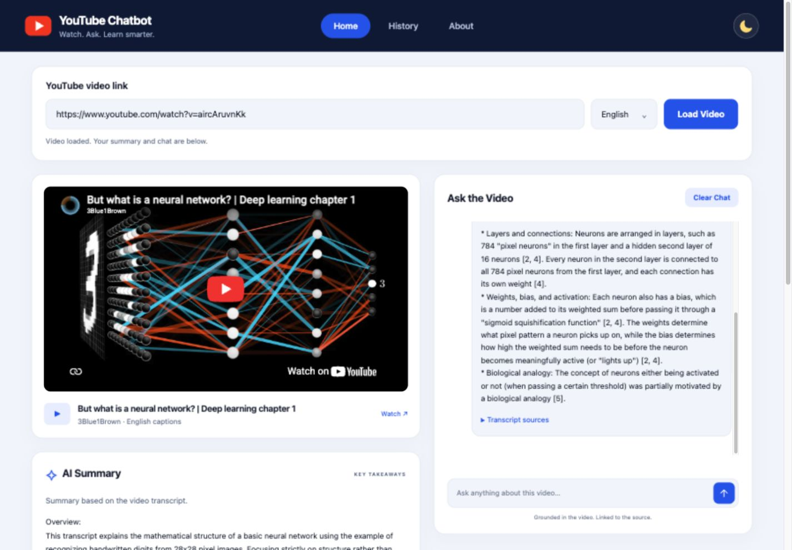

# YouTube Chatbot

Ask questions about a YouTube video, read an AI summary, and explore the timestamped transcript behind each answer.



## Features

- Load public YouTube videos with available English captions.
- Generate a transcript-based overview and key takeaways automatically.
- Ask follow-up questions and inspect timestamped source passages.
- Play the video alongside the summary and chat.
- Switch between light and dark themes and revisit recent video links.
- See background summary progress and actionable provider errors.

## How it works

```text
YouTube link → timed captions → overlapping chunks → TF-IDF retrieval
                                                        ↓
Question + recent conversation + source passages → Gemini → answer + sources

Full transcript → section summaries when needed → video summary
```

The current retrieval baseline uses TF-IDF and cosine similarity, not neural embeddings. Captions are split into 140-word chunks with a 30-word overlap. Chat uses up to five matching chunks and the most recent eight conversation messages. A question without matching passages receives a no-match response instead of making an AI request.

Gemini is instructed to answer only from the supplied evidence. Generated content can still contain errors; inspect the linked transcript sources. Visual-only information is not analyzed. Semantic embeddings, transcript-provider fallbacks, and durable storage are planned improvements.

## Stack

Python 3.12 · FastAPI · Gemini Interactions API · youtube-transcript-api · HTML · CSS · JavaScript

The frontend and API share one server. API keys remain on the backend.

## Run locally

```sh
python3.12 -m venv .venv
source .venv/bin/activate
python -m pip install -r requirements.lock
cp .env.example .env
```

If you already have a configured `.env`, keep it instead of copying the example over it. Set `GEMINI_API_KEY` in `.env` to your own key. `GEMINI_MODEL` can be changed to a model supported by your account and the Interactions API.

```sh
python -m uvicorn app.main:app --reload
```

Open http://127.0.0.1:8000. Interactive API docs are at `/docs`. Restart after changing `.env`.

## Deploy to Render

1. Publish this source to your GitHub repository, excluding `.env` and `.venv`.
2. Create a Render Blueprint from that repository. The included `render.yaml` defines a Python web service.
3. Supply `GEMINI_API_KEY` as a secret environment variable in Render. Never put the value in the YAML or repository.
4. Deploy and use the `https://…onrender.com` URL returned by Render.
5. Verify loading a video, summary completion, and a timestamped chat answer on the deployed URL.

The service uses one worker because indexes and jobs are stored in process memory. They expire after an hour, can be evicted after eight loaded sessions, and are lost on restart. Free hosting can sleep when idle. YouTube can block caption requests from cloud-hosted IPs, even for videos that work locally; provider fallbacks are not implemented yet.

This is a portfolio demo. Gemini quotas and usage costs depend on the configured account. Public visitors share the backend's provider quota. Authentication, per-user usage controls, shared job storage, and durable caching are needed before a broader production rollout.

## Privacy

Transcripts and questions are sent to Google for generation. Interactions use `store: false`, subject to Google's applicable service policies. The last 12 loaded video links and titles, plus theme preference, are saved in this browser's local storage. Chat is kept in browser memory. Transcript indexes and summaries stay temporarily in server memory. Only process videos you are permitted to use.

## Validation

```sh
python -m unittest discover -s tests -v
node --check app/static/app.js
```

Tests cover URL validation, chunk overlap, timestamps, ranking, no-match behavior, session expiry, background summary jobs, provider error handling, retries, and grounding payloads. Provider responses are mocked in automated tests. Local live caption, summary, and chat flows have also been exercised; verify them separately after deployment.

## Project structure

- `app/main.py`: HTTP routes and background summary jobs.
- `app/transcripts.py`: YouTube URL parsing and timed caption retrieval.
- `app/retrieval.py`: chunking, TF-IDF ranking, and temporary index storage.
- `app/ai.py`: backend Gemini requests and provider error handling.
- `app/static/`: responsive video, summary, and chat interface.
- `tests/`: backend unit tests.
- `requirements.lock`: exact installed dependencies used for deployment.
- `render.yaml`: Render service configuration, without credentials.
